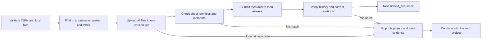

# PlanGrid to Kahua migration

This repository contains separate workflows for the same migration
project. They share project guidance and handover records, but have separate
entry points, dependencies, and run state. Keeping them together makes one
repository the source for migration work without requiring either runtime to
install the other.

| Workflow | Source and entry point | Runtime | Guide |
| --- | --- | --- | --- |
| Drawings and revisions | `kahua_migration/`; `python -m kahua_migration browser migrate` | macOS or native Windows; Python 3.10+, Playwright and offline OCR | [AUTOMATIC_RUN.md](AUTOMATIC_RUN.md) |
| Project sync flags only | `scripts/windows-local-sync/`; `Invoke-KahuaSyncFlags.ps1` | Windows PowerShell 5.1 and Kahua for Windows | [SYNC_FLAGS.md](SYNC_FLAGS.md) |
| Documents and photos | `scripts/windows-local-sync/`; `Invoke-KahuaSyncBatch.ps1` | Windows PowerShell 5.1 and Kahua for Windows | [LOCAL_FILE_SYNC.md](LOCAL_FILE_SYNC.md) |

For **Doe's simpler flag workflow**, use [SYNC_FLAGS.md](SYNC_FLAGS.md). It reads
exact project names, sets each project's own Folders switch to the requested
boolean, and verifies the saved setting. Doe places the files and Kahua handles
the transfers. Five live project reads passed, and Seattle completed a saved
Disable/Enable cycle after the Save wait was corrected. The guide records the
50 passing simulated scenarios, exact-name CSV correction, and pilot limits.

For **documents and photos**, see [LOCAL_FILE_SYNC.md](LOCAL_FILE_SYNC.md).
The PowerShell CSV runner selects existing projects, controls Local Files Sync,
and verifies downloaded originals by SHA-256 before checking sync is off.
See the runbook for prerequisites and current validation limits, and
[KAHUA_WINDOWS_HANDOVER.md](KAHUA_WINDOWS_HANDOVER.md) for the issue register,
responsibility boundaries, and risk ratings. Unattended batch operation is
currently rated **High risk**. The drawing workflow below remains separate.

Windows commands run from the repository root. Plan the sync-flag workflow:

```powershell
.\scripts\windows-local-sync\Invoke-KahuaSyncFlags.ps1 `
  -CsvPath C:\Migration\sameProjectsEnableSync.csv `
  -Environment DEVPRODUCTION -Action Enable -Mode Plan `
  -StateRoot C:\Migration\runs\enable-project-sync
```

Follow [SYNC_FLAGS.md](SYNC_FLAGS.md) for Check, Enable, Disable, and per-row
boolean values. For the full documents/photos workflow, plan with:

```powershell
.\scripts\windows-local-sync\Invoke-KahuaSyncBatch.ps1 `
  -CsvPath C:\Migration\projects.csv `
  -StateRoot C:\Migration\runs\documents-batch `
  -Mode Plan
```

The full workflow's Plan stages and checks the local inputs. Follow its runbook before
Check or Execute. The Windows fixture workflow runs separately in GitHub
Actions, without Kahua access; its results do not establish live upload safety.
Source archives, downloaded originals, journals, session logs, and credentials
remain local and are excluded from source control.

## Drawing workflow

For the CSV-driven project queue, start with [AUTOMATIC_RUN.md](AUTOMATIC_RUN.md).
Run `browser migrate` to read the CSV, find or create the named projects and
folders, and process all version sets without selecting destinations manually.
Projects run in numeric `project_sequence` order; each project's version sets
finish in `upload_sequence` order before the next project starts. Both orders
appear in the plan for review.
Sign-in and MFA are manual when Kahua requires them.

The drawings browser command now has a shared offline OCR adapter: the existing
Swift/Apple Vision helper on macOS and native Tesseract 5 on Windows. OCR locates
canvas controls and reads target metadata; source metadata still comes from
CSVs and drawing logs. Exact labels, unique matches, confidence ≥ 0.95, geometry
and canvas-overlay checks remain enforced. Planning requires neither Chrome nor
an OCR installation. The guide includes copyable setup, plan, execution, result
checking and same-journal resume commands for both operating systems.

The portability tests cover adapter contracts, UTF-8/paths with spaces,
coordinate scaling, CLI behavior, intercepted browser fixtures, ordered batches,
project isolation and uncertain-Save reconciliation. A separate hosted Windows
fixture job is defined in `.github/workflows/drawings-portability.yml`.
[All 171 hosted Windows fixture tests passed](https://github.com/jaintj95/kahua-migration/actions/runs/42035787165)
on November 5, 2026, with native Python, Tesseract and Chrome; all 171 also passed
on macOS with Tesseract. On the user's Windows VM, 170 passed and one symlink
fixture skipped because the account lacks symbolic-link creation privilege.
The VM also passed an engine-free, two-project plan-only check and rejected a
duplicate version-set order. [Validation details and evidence locations](AUTOMATIC_RUN.md#portability-validation-scope)
are in the run guide. Live Windows Kahua validation remains pending; synthetic
tests do not establish tenant compatibility or unattended migration reliability.
The Windows documents/photos and sync-flag scripts above are separate workflows.

Initial requirements and workflow notes are in [call_notes.md](call_notes.md).

The previous manual version is preserved at `manual-pilot-v0.1.0`, with its instructions in
[MANUAL_RUN.md](MANUAL_RUN.md).

The chosen route for drawings is **browser automation**. Files go directly from the local disk to Kahua, without API credentials, middleware transfers, Finder automation, or paid model calls. The source auditor, per-sheet revision calculation, durable journal, browser controls and verification code are implemented.

The automatic worker completed live calibration for **five PDF revisions,
four batches and two CSV destinations**. It created the missing test project
and three Controlled folders, navigated from the CSV, and retained the expected
revision history. Every original PDF was downloaded after release and matched
its source hash. The run required code fixes and supervised recovery, including
a transient Kahua download-service error. Historical pilot results are retained
below. **A fresh uninterrupted upload run, a cold CLI execution, and a
1,000-project rollout have not been validated.**

| Command | Destination selection | Scope |
|---|---|---|
| `browser migrate` | Automatic from CSV | Project queue; every audited batch; one PDF per upload |
| `browser pilot` | Operator opens the destination | Earlier bounded four-record/two-file pilot |
| `browser run` | Generic profile recipes | Older adapter; tenant recipes remain uncalibrated |

The new automatic worker uses the full export and unfiltered UI count for
membership, then exact batch/sheet filters for each record's metadata, workflow
and original bytes. It does not inherit the pilot's four-record limit. It
creates blank projects at the domain root and Controlled folders; project
templates and nested project creation are unsupported. The optional API
prototype is retained separately.

## The agreed revision rule

`upload_sequence` orders entire version-set folders. It does not set revision numbers.

| Sheet | Bid Set, sequence 1 | Revision abc, sequence 2 | Later set, sequence 3 |
|---|---|---|---|
| A, appears in all three | Revision 1 | Revision 2 | Revision 3 |
| B, first appears in set 2 | — | Revision 1 | Revision 2 |
| C, skips set 2 | Revision 1 | — | Revision 2 |
| D, first appears in set 3 | — | — | Revision 1 |

For the example of a 23-file Bid Set followed by a 5-file Revision abc, every file in the first folder finishes the workflow before the second folder starts. Each of the five later files receives either revision 1, if new, or the next revision for that sheet. Kahua's auto-increment result must match the value calculated from the source history.



`Current` is a derived comparison set and is never uploaded. The default identity is the exact `Sheet Name` from the drawing log. Case collisions, duplicates and missing files block the project. If the source's stable sheet identity later changes, resolve that mapping before changing this rule.

## Run the source checks now

The core uses Python 3.10+ and the standard library.

```sh
python3 -m kahua_migration audit \
  --version-sets version_sets.csv \
  --config migration.example.json \
  --out output/preflight

python3 -m kahua_migration plan \
  --manifest output/preflight/manifest.json \
  --out output/plan
```

Audit exit code 2 means the report contains errors that block one or more projects; the reports are still written. `plan` makes no network requests. Browser destinations are mapped by environment, domain name, exact project number/name and folder path; API IDs and OAuth credentials are not required.

The supplied complete source sample contains 166 historical PDFs in three batches: **61, 52, 53** files, with **64 current sheets**. The CSV also names a second project whose source files are absent. Production destination mappings are not supplied. Five `Current` PDFs have different hashes from the corresponding historical PDFs. Their first-page renders matched at 36 DPI, which is limited visual evidence, not proof of byte-level or annotation equivalence. These differences remain in the audit.

## Completed assisted live pilot

The approved destination is `DEVPRODUCTION → Onindus → 0001 - 220 - Seattle Heights → Sheets/Migration Pilot`. On October 29, 2026 (India time), all three pilot batches completed through the live browser with operator file selection. All four revision records completed submit, accept and release:

| Sheet | Revision | Batch | Revision and batch dates | Current state | Original PDF integrity |
|---|---|---|---|---|---|
| 1 | 1 | Bid Set - 7/22/2025 | July 22, 2025 | Superseded; Current Rev: No | 1,433,251 bytes; SHA-256 matches source |
| 1 | 2 | Revision - 12/12/2025 | December 12, 2025 | Superseded; Current Rev: No | 1,394,257 bytes; SHA-256 matches source |
| 1 | 3 | Roadway Revision - 4/13/2026 | April 13, 2026 | Released; Current Rev: Yes | 1,394,225 bytes; SHA-256 matches source |
| ROADWAY-SIGN4 | 1 | Roadway Revision - 4/13/2026 | April 13, 2026 | Released; Current Rev: Yes | 190,062 bytes; SHA-256 matches source |

Kahua recognized sheet 1 as **Revise**, retained its number and title, and its Auto-Increment action correctly produced revisions **2** and **3**. Auto-Increment left the new sheet's revision blank; setting revision **1** only where blank preserved sheet 1's calculated revision **3**. The final mixed batch was filtered by its batch name and both records were submitted, accepted and released together. Its submit dialog confirmed file version **1** for both records.

The unfiltered Default view contains exactly **four revision records** and **two current sheets**. Sheet 1's revisions 1 and 2 remain accessible as superseded, with their original batch names and dates. Sheet 1 is titled **TITLE SHEET**; ROADWAY-SIGN4 is titled **SIGNATURE SHEET**. Each original PDF was downloaded and hashed before its submission. Earlier revisions were not downloaded again after superseding.

Evidence is saved in `output/browser-evidence/live-pilot-events.jsonl`, four `*-integrity.json` files, `pilot-final-status.png`, `pilot-progress.json`, and the individual released/superseded screenshots. This is an assisted live pilot, not a run of the standalone Playwright worker. A later standalone read-only audit passed for all four records, as described below. Unattended upload execution remains unvalidated. The pilot folder is nonempty; do not start a new journal and replay the full pilot manifest into it.

`pilot/` contains copies of four audited source files, a separate CSV/configuration/manifest, and provenance linking back to the full source audit. Its source audit has zero errors and zero warnings. This does not mark the browser adapter as validated.

| Batch | Local files | Expected revisions |
|---|---|---|
| Bid Set - 7/22/2025 | `pilot/source/Drawings/01/1.pdf` | Sheet 1 → 1 |
| Revision - 12/12/2025 | `pilot/source/Drawings/02/1.pdf` | Sheet 1 → 2 |
| Roadway Revision - 4/13/2026 | `pilot/source/Drawings/03/1.pdf`, `ROADWAY-SIGN4.pdf` | Sheet 1 → 3; ROADWAY-SIGN4 → 1 |

The standalone controls were calibrated in their own browser session. File selection during the first assisted pilot was performed by the user; Finder was not automated. The user approved a second four-file test in `Sheets/Migration Automation Pilot`, using the audited proposal under `output/automation-pilot-proposal/` and its own journal. This authorization does not include other projects or the full source sample.

### Completed standalone browser calibration

The approved second destination is `DEVPRODUCTION → Onindus → 0001 - 220 - Seattle Heights → Sheets/Migration Automation Pilot`. All four files were attached through Playwright's file-chooser interface, using Uno's HTML input fallback. No native file picker was operated.

The three batches completed in order, with the same final metadata and history shown in the table above. Sheet 1 has revisions 1 and 2 superseded, and revision 3 released/current. ROADWAY-SIGN4 starts at revision 1 and is released/current. All four revisions are accepted and each has exactly **one file version**. Original filenames, titles, batch names, batch dates and revision dates matched the source. Original PDFs were hashed before submission and downloaded again after all releases; all four retained files still match their source SHA-256 values and byte counts.

The journal at `state/automation-pilot.sqlite` contains four verified operations, three completed batch checks and no pending mutations. Preserve it: a new journal must never be used to replay uploads into this populated folder.

| Evidence | File |
|---|---|
| Final metadata, history and file-version audit | `output/automation-pilot-run/final-audit/metadata-audit.json` |
| Independently observed records and screenshots | `output/automation-pilot-run/final-audit/readback-report.json` |
| Original bytes checked after all releases | `output/automation-pilot-run/retained-originals/integrity-report.json` |
| Packaged runner's live resume result | `output/automation-pilot-run/worker-resume-check/run-report.json` |
| Current calibration status | `output/automation-pilot-run/progress.json` |

This was interactive calibration of the standalone script: code and targeting corrections were required while it ran. It is distinct from a fresh, uninterrupted command-line upload test. The later `PilotRunner.run()` resume test completed automatically against the finished journal: it skipped all completed mutations, independently audited the four records, and downloaded and hashed all four originals again.

The calibration exposed and fixed several concrete problems. Enter or Escape from a date calendar could close the parent upload wizard, so the upload worker now reads the calendar's selected-day label and closes it by clicking the bound date field. Upload columns resize and their semantic coordinates can become stale; field targeting combines visible labels, complete row membership, column widths and explicit column indices. All row checkboxes could report the first row's coordinates, so selection clicks the correctly positioned parent gridcell and checks the separate checkbox state; Submit/Accept review rows must then match the exact intended batch. A cancelled precommit attempt is retried only after a fresh audit proves that no new records were saved and old file versions were unchanged. An uncertain Save is never retried.

### Run the bounded pilot or resume its verification

```sh
.venv/bin/python -m kahua_migration browser pilot \
  --manifest output/worker-validation-proposal/manifest.json \
  --journal state/worker-validation.sqlite \
  --ocr-executable output/tools/ocr-screenshot \
  --channel chrome --out output/worker-validation-resume --execute
```

Close any other migration process using the same Chrome profile first. Sign in manually and open the exact folder named by the manifest, then continue at the terminal prompt. With the completed manifest and journal above, this command performs verification without repeating uploads. Omitting `--execute` saves a plan and makes no browser requests.

The command owns complete batches: attach, set metadata, read every precommit field, save once, independently export/read/download, submit, accept, release, then verify the complete history before starting the next batch. Unknown outcomes remain pending; they never trigger blind retries. Source or target changes invalidate journal reuse. A final Save intent cannot be recorded twice, including after restart.

### Completed worker validation

The user approved the proposal under `output/worker-validation-proposal/`, containing the same four PDFs (4,411,795 bytes) with zero source-audit errors or warnings. The controlled folder `Sheets/Migration Worker Validation` was created in the same test project. Execution completed all three batches using `state/worker-validation.sqlite`.

The final audit found exactly four revisions, each accepted and with one file version. Sheet `1` has superseded revisions `1` and `2`, with revision `3` released/current. `ROADWAY-SIGN4` is released/current at revision `1`. Titles, original filenames, batch names, batch dates and revision dates match the source. All four retained PDFs were downloaded after release and match their original SHA-256 values and byte counts.

This run required code corrections and supervised recovery, including completing already-attached forms before the second and third Saves. It therefore did **not** pass its intended clean, uninterrupted upload test. The final resumed `PilotRunner.run()` completed successfully. The full CLI launch remains untested. All earlier attempts, precommit reviews and recovery evidence are retained under `output/worker-validation-run/`; no uncertain Save was replayed.

A second `PilotRunner.run()` against the completed journal then passed without intervention. It independently re-read all four records and re-downloaded all four original PDFs. The journal stayed unchanged at **66 events**, with four verified operations and three completed batch checks; no uploads or workflow commands were repeated.

| Evidence | File |
|---|---|
| Consolidated result, scope and remaining limits | `output/worker-validation-run/validation-summary.json` |
| Successful resumed run and zero-issue metadata comparison | `output/worker-validation-run/attempt-17/run-report.json` |
| Final independent metadata and history observations | `output/worker-validation-run/attempt-17/006-project-final/readback-report.json` |
| All original PDFs verified after release | `output/worker-validation-run/attempt-17/final-originals/integrity-report.json` |
| Completed-journal resume and unchanged event count | `output/worker-validation-run/completed-resume/resume-proof.json` |
| Local regression results and source fingerprints | `output/worker-validation-run/local-test-results.json` |

The corrections handle resized or partially hidden upload columns, stale cell positions, filename identity across horizontal scrolling, calendar focus, and changing record-row labels. Offscreen fields stay unknown until observed; filename identity can carry across a scroll only on the same previously observed row. Focused OCR crops must pass the original confidence threshold for both label and value. None of these changes expands the four-record/two-file limit.

Preserve `state/worker-validation.sqlite`: it contains four verified operations, three completed batch checks and no pending mutation. Never replace the journal or replay completed uploads into this populated folder.

### Standalone read-only audit

The Playwright session independently read all four original pilot records and verified exact titles, batch names and dates, revision dates, current flags, released/superseded status, accepted QA status, and one file version per revision. The report and screenshots are in `output/standalone-readback/`; `metadata-audit.json` records zero mismatches. This audit does not download or hash original PDFs.

The audit combines the live semantic grid with local macOS Vision recognition of read-only detail screenshots. It uses no model API. Missing, ambiguous or low-confidence values stop the audit. The detail navigation count must match the visible grid, so virtualized large logs stop instead of being reported as complete. A one-record draft folder was also read successfully using an export obtained in the same browser session to cross-check membership; Kahua omits its detail navigation total when there is only one record. Empty-log readback and large-log pagination remain unvalidated.

```sh
mkdir -p output/tools/swift-cache
swiftc -module-cache-path output/tools/swift-cache \
  scripts/ocr_screenshot.swift -o output/tools/ocr-screenshot
.venv/bin/python -m kahua_migration browser audit \
  --manifest pilot/manifest.json --channel chrome \
  --ocr-executable output/tools/ocr-screenshot \
  --out output/standalone-readback
```

Sign in manually and open the intended folder before continuing at the prompt. The live audit implementation passed in the calibration session; the complete fresh CLI launch has not yet been exercised. Its current layout requires a 1600 × 1000 browser viewport. The audit never opens Edit, uploads, saves, or invokes workflow actions.

The pilot exposed several calibration details. Standard semantic-input filling and selection sometimes appended text rather than replacing it; clicking the visible canvas field and using native keyboard selection worked. The worker reads each edited input back after leaving it and stops before the next recipe step on any mismatch; reliable automatic field targeting still needs calibration. The upload grid resized columns after text entry, so targets must be resolved again after each edited field. Accessibility IDs changed when records reopened, some text nodes retained stale values, and portions of the final detail were absent from the accessibility tree despite being visible on screen. The final released/current and superseded states were verified visually. Do not copy transient IDs into production recipes or treat absent/stale accessibility values as authoritative. Removing the batch filter through its checkbox/chips did not reliably restore all records in this session; switching to **Default** restored the verified four-record view. Original-file downloads sometimes delayed browser interaction for several minutes even though they ultimately completed; check completion before retrying.

## Browser worker

Install Playwright in a project virtual environment, then install its browser:

```sh
python3 -m venv .venv
.venv/bin/python -m pip install -e '.[browser]'
.venv/bin/python -m playwright install chromium

.venv/bin/python -m kahua_migration browser login
.venv/bin/python -m kahua_migration browser inspect --out output/browser-inspection
```

These commands open a separate headed browser. Sign in manually. The browser session stays locally under ignored `state/browser-profile/`. The inspector saves an accessibility snapshot and screenshot; it does not upload drawings.

Copy `browser-profile.example.json` to `browser-profile.local.json` and complete it using the live pilot. The example records controls actually observed, but leaves untested recipes null. Recipe actions use exact names, guard the selected project/folder/record, and stop on ambiguous matches. The active-size filter addresses the stale miniature semantic controls observed in Kahua; it does not make arbitrary selectors safe.

The drawing-log verification view must expose all revisions, with filters cleared. CSV columns are mapped explicitly. Fields absent from that CSV can be read from the real record detail through `detail_fields`. Neither path fills missing target metadata with values from the source plan. The exported row count must match the unfiltered visible count. A target download is hashed to verify the uploaded PDF. If Kahua transforms the downloadable original, that requires an explicit fidelity decision; the worker currently stops on any hash difference.

The top-level **Export** produced `output/browser-evidence/pilot-final-export.xlsx`. Its `Drawing` tab contains exactly two sheets; `DrawingRevision` contains exactly four revisions. Joining `DrawingRevision.Drawing` to `Drawing.RowNumber` verifies all sheet numbers, titles, revisions and original filenames against the pilot manifest, with four distinct revision record keys. Results are in `pilot-final-export-audit.json`. The exported `CurrentRevision` column is **blank for every row**; batch dates, revision dates, workflow state and file versions are also unavailable from this export. These remain separate UI observations and must never be filled from expected source values. The grid **More → CSV** command was previously observed but its activation remains unvalidated; its menu rendered empty during the final check. The bounded pilot now combines this export with semantic/UI readback and original-file hashes. The generic CSV-profile path remains uncalibrated.

After the profile has been completed and verified:

```sh
.venv/bin/python -m kahua_migration browser run \
  --manifest pilot/manifest.json \
  --profile browser-profile.local.json \
  --journal state/pilot.sqlite \
  --out output/pilot-run \
  --manual-files \
  --execute
```

`--manual-files` hands file selection to the operator. Without that option, the worker attaches a file through Playwright's file-chooser interface; it never drives Finder or Explorer. All four pilot attachments, including the mixed two-file batch, were proven with the HTML upload fallback. A clean unattended run of the packaged upload path remains unvalidated. Omit `--execute` to save a plan without writing to Kahua.

For production, replace the pilot manifest with a newly audited full manifest and use a separate journal. All invocations for the same destination migration must share that journal. This first worker runs one operation at a time. It is designed to process a queue of projects and continue after a project fails, but throughput and long-run browser stability have not been benchmarked. Its current verification path favors correctness over speed and will need measurement before a 1,000-project rollout. No LLM calls are used.

## Resume and evidence

Every mutation has an intent persisted in SQLite first. A timeout or process crash leaves an unresolved intent. On restart the worker reads the target: if the exact intended result is present, it confirms that stage and continues. It never repeats an uncertain upload just because the previous request failed. This avoids accidentally creating another version of the same revision.

If the target result cannot be established, the project stays blocked for investigation. Do not delete the journal or clear pending rows to force a retry. A completed batch has a separate persisted verification record, so a crash between per-file completion and the batch check cannot bypass the batch boundary. Changed source hashes, destination bindings or browser profiles cannot silently reuse earlier receipts.

`run-report.json` reports success/failure per project and completed batches. `evidence/` retains verification observations and mutation receipts. Browser failures also save screenshots when available. Final verification checks exact metadata, revision history, current flags, released/superseded state, and downloaded SHA-256/byte counts.

## Validation and limits

```sh
.venv/bin/python -m unittest discover -s tests -v

# Also exercise real Chrome controls, screenshots and local OCR against
# intercepted fixture pages. Requires Chrome and output/tools/ocr-screenshot.
KAHUA_BROWSER_TESTS=1 .venv/bin/python -m unittest discover -s tests -v
```

Tests cover source/revision rules, journal recovery, batch boundaries, exported metadata parsing and strict missing-field handling. The HTTP integration tests run the real API client against a localhost stand-in using published endpoint shapes and synthetic tenant fields. They establish orchestration behavior; **they do not validate the browser adapter or the live Kahua tenant**. The local HTTP tests require permission to bind localhost. No paid service calls are needed.

The complete suite has 139 passing tests, including seven opt-in Chrome tests.
It covers CSV destination mappings,
creation-intent recovery, exact project identity, directory traversal,
whole-batch ordering, project failure isolation, plan-only execution,
pending-upload recovery, repeated-Save prevention, mismatched metadata,
duplicate file versions, exact workflow review rows, date parsing, guarded
canvas targeting, delayed detail-pane loading, bounded read-only download
recovery, and completed-pilot resume without writes. The complete suite
passed on October 29, 2026 with localhost access for the synthetic HTTP fixtures.
Local fixture tests and small live pilots are different evidence.

Project failure tests now inject attachment, metadata preparation, uncertain
Save, readback, original-file verification and workflow failures. They require
the failed project to pause and the next project to finish. Reopened-journal
tests prove that saved revisions reconcile without another Save and unknown
outcomes stay paused. The synthetic target deliberately allows duplicates;
its file-version counter detects an accidental repeated Save.

The optional Chrome tests exercise the real queue and journal with synthetic
upload/workflow boundaries, real dialog controls, OCR and tab replacement.
They cover Cancel, disabled Cancel with Close, a lost keyboard action, a delayed
"Upload Failed" notice, unknown notices, and unavailable dismissal controls.
All URLs are intercepted locally. The live tenant does **not** carry sign-in to
a replacement tab, so in-app recovery is the primary path. Authentication loss
and a UI that cannot be recovered can still block the queue. See
`AUTOMATIC_RUN.md` for paused-project reporting and resume rules.

The automatic worker's live queue calibration completed the following scope
on October 29, 2026, in `DEVPRODUCTION → Onindus`:

| Project and folder | Verified result |
|---|---|
| Existing `0001 - 220 - Seattle Heights`, `Sheets/Migration CSV Queue Validation` | One batch; sheet `1`, revision `1`, released/current |
| Created `CSV20261029 - Kahua CSV Automation Validation`, `Sheets/Imported` | Three ordered batches; sheet `1` revisions `1` and `2` superseded, revision `3` released/current; `ROADWAY-SIGN4` released/current at revision `1` |

All five revisions are accepted, have one file version, and retain the expected
titles, filenames, batch names, batch dates and revision dates. All five
original PDFs were downloaded after release and match their source SHA-256
values and byte counts. The live event timestamps confirm whole-batch stage
ordering and that a version set finished before the next began uploading.
The preserved journal has five verified operations, four completed batch
checks, exactly five upload Save intents, and no pending operation.

This was calibration with supervised recovery, not a fresh uninterrupted
upload test. Corrections addressed delayed or hidden controls, calendar focus,
file-chooser activation and a detail pane whose tabs arrived late. Two
already-attached upload forms were completed with precommit checks. A final
read-only download returned Kahua HTTP 500 / `SVC-895992`; its retry succeeded
with matching bytes. The worker now recognizes the observed service errors
and permits one read-only download retry. It never retries an uncertain Save.

Completed-journal verification then passed without intervention. The worker
automatically found both destinations, freshly audited all five revisions and
downloaded all five originals again. Operations, workflow events and batch
checks were unchanged: 65 events and five upload Save intents. Destination
confirmation timestamps were refreshed. This verifies resume from a completed
mutation journal; it is separate from a fresh uninterrupted upload test.

The real plan-only CLI passed for both projects, with five files, zero source
audit issues and no journal created. A fresh CLI launch with `--execute` has
not been tested. Local evidence is retained under
`output/automatic-queue-validation/`; it is excluded from the source ZIP.

| Evidence in the original workspace | File |
|---|---|
| Consolidated scope, independent checks and limitations | `output/automatic-queue-validation/validation-summary.json` |
| Successful two-project verification | `output/automatic-queue-validation/run-11/run-report.json` |
| Unchanged operation journal across resume | `output/automatic-queue-validation/run-11/resume-proof.json` |
| Passing 116-test suite and source fingerprints | `output/automatic-queue-validation/final-local-test-results.json` |
| Real plan-only CLI invocation | `output/automatic-queue-validation/final-cli-plan/cli-proof.json` |

An additional live failure-isolation check staged one existing test PDF and
injected an attachment-stage failure while Kahua's real Add Files form was
open. The queue marked that project paused, cancelled the form, acknowledged
the delayed "Upload Failed" notice, and automatically completed the next
project's read-only metadata and original-file hash verification. No final
Save was invoked. A copy of the completed journal retained the same 65 mutation
events, operations and batch checks; the original journal was opened read-only.
Live uncertain-Save failures were not injected: those scenarios are covered by
the local target that deliberately allows duplicate saves.

| Failure-isolation evidence in the original workspace | File |
|---|---|
| Real upload-form recovery and next-project verification | `output/project-isolation-validation/live-handoff-04/run-report.json` |
| Unchanged journal and precise live-test scope | `output/project-isolation-validation/live-handoff-04-proof.json` |
| Final regression results and source fingerprints | `output/project-isolation-validation/full-test-results.json` |
| Final paused-folder membership export | `output/project-isolation-validation/final-membership/export/membership.json` |

Large-project throughput, long-running browser stability and tenant-specific
layouts need measurement before production rollout. The old pilot command's
four-record/two-file limit remains in place; the automatic command uses one-file
uploads and exact record filters instead of large upload tables or scrolling
record selection. None of these results marks the older generic profile as
verified.

## References

- [Kahua: adding files to controlled folders](https://help.kahua.com/main/Content/4-DocumentationMngmt/File-Manager/cf-add-files.htm)
- [Kahua: controlled-folder workflow](https://help.kahua.com/main/Content/4-DocumentationMngmt/File-Manager/cf-review-workflow.htm)
- [Playwright: file input and file chooser support](https://playwright.dev/python/docs/input#upload-files)
- [Kahua API documentation](https://help.kahua.com/main/Content/DevHelp/Integration/APIHomePage.htm), used for the optional API prototype and local orchestration tests.
